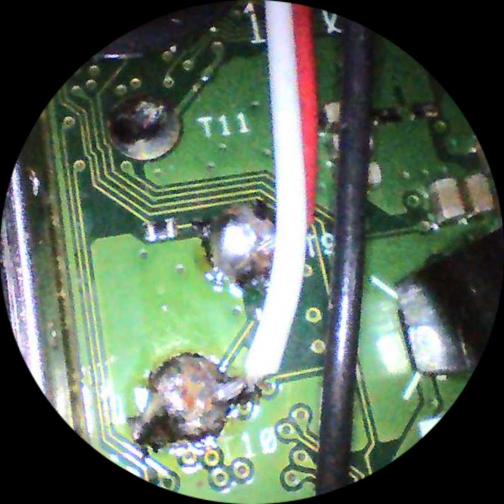
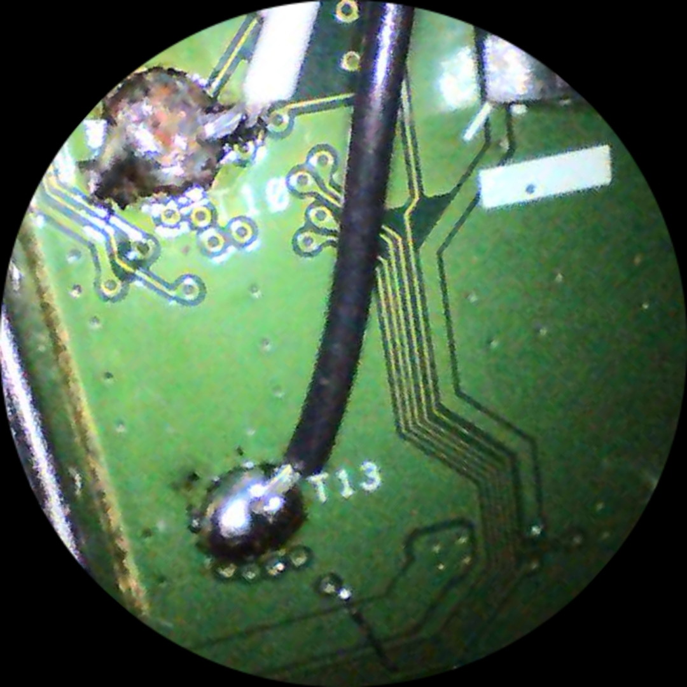
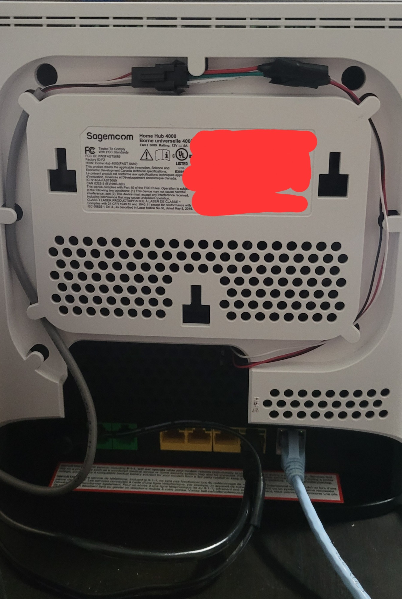

# Installing and updating HH4000-OpenWrt

This experimental port targets the Bell Home Hub 4000 **Sagemcom FAST5689
(BCM6858)**. It uses OpenWrt 24.10.4 ARM64 userspace with the retained vendor
Linux 4.1.52 kernel and board drivers. Check the model on your own unit before
preparing any image.

The public checkout supports building a candidate, testing it in RAM on a
system that already boots compatible images, and updating an existing
HH4000-OpenWrt installation. The stock Bell system has no supported first-time
installation path in this checkout. If your unit is still stock, you can set
up the console and prepare a private backup, but stop before writing flash.
Use of the updater requires the HH4000-OpenWrt firmware/data partition layout.

## 1. Set up the serial console

Use a **3.3 V TTL UART** adapter at **115200 baud, 8 data bits, no parity,
1 stop bit (8N1), no flow control**. The
[HH4000 UART jig](https://github.com/up-n-atom/hubrxtx) connects without
soldering to the board. For direct wiring, unplug the router before opening
it. A fastener is hidden behind the display assembly. Avoid prying on the
display glass to reach it.

| Board pad | Signal at the router | Connect to |
| --- | --- | --- |
| T9 | RX, router input | Adapter TX at 3.3 V |
| T10 | TX, router output | Adapter RX |
| T13 | GND | Adapter GND |
| T11 | PWR | Leave disconnected |

Leave adapter VCC disconnected and power the router from its normal supply.
A 5 V microcontroller needs level conversion on its TX line. Check that you
can capture readable boot logs before relying on the console for recovery.
UART carries commands and logs. Use Ethernet or a verified file transfer
from the installed OS for firmware images.

The [Arduino Mega bridge](Arduino/hh4000_bridge) defaults to 115200 on both
links. For a different target, send the bridge a line such as
`@HH BAUD 9600`, or pass `--target-baud 9600` to the Python client. The
USB link stays at 115200. Resetting the Arduino restores the target default.

### UART reference photos

The microscope views show the signal leads and ground pad. Match your
board's pad labels to the table before connecting the adapter.

<a href="assets/uart-signal-pads.jpg"></a>
<a href="assets/uart-ground-pad.jpg"></a>

<details>
<summary>Rear connector, cable routing, and Arduino shield</summary>

The development router routes the three UART leads through an opening in
the rear case to a detachable connector.

<a href="assets/uart-rear-overview.jpg"></a>

- [Rear UART connector close-up](assets/uart-rear-connector.jpg)
- [Where the UART leads exit the case](assets/uart-cable-exit.jpg)
- [Arduino Mega UART prototype shield](assets/arduino-uart-shield.jpg)

The Arduino build is optional. During installation and updates, power
the router directly from its normal power adapter.

</details>

## 2. Prepare local build inputs on Linux

Keep a verified backup of your unit's original firmware, calibration and
configuration on another machine. For an update, also keep the current
OpenWrt configuration and a known-good RAM image off the router. Treat vendor
files, calibration, credentials and complete built images as private.

The repo supplies the platform source and assembly scripts. For a full
candidate, prepare these inputs using the
[platform build notes](src/openwrt-hh4000/README.md#local-build-inputs)
and [research index](docs/README.md):

| Local input | Expected path or version |
| --- | --- |
| Prepared OpenWrt root tree | `work/openwrt-integrate/rootfs` or `work/openwrt-install/rootfs`; OpenWrt 24.10.4 `armsr/armv8` base, HH4000 runtime, LuCI and rescue files |
| Board-specific runtime and calibration | Your own compatible vendor filesystem at `work/rootfs` and extracted calibration/configuration under `work/ubi`; see `tools/build_openwrt_net.py` |
| Additional runtime executables and libraries | [Local binary list](src/openwrt-hh4000/local-binaries.txt); provide them in the prepared root or ignored overlay paths, with the ABI indicated in the platform notes |
| AArch64 musl cross-compiler | Official OpenWrt 24.10.4 SDK unpacked under `work/lan-fix/sdk` |
| ARM32 vendor-glibc build configuration | `work/display/live/build-settings.json` with `compiler`, `base_arguments`, and `tail_arguments`; see the platform notes |
| Package metadata inputs | `work/wan-firewall/package-manifest.json`, `work/wan-firewall/packages`, `work/wan-firewall/stock-module-order.json`, and `work/security-audit/source-manifest.json` |
| SKIPLOG build inputs | Matching vendor `xt_SKIPLOG.ko` in the prepared root's `lib/modules/4.1.52-5.02L.07`, OpenWrt libxtables 1.8.10 ABI 12, and the verified source archive below |

You also need Python 3, host GCC, ARM32 binutils (`arm-linux-gnueabi-strip`),
`cpio`, `mkimage` and SquashFS tools. For SKIPLOG, place the official
[iptables 1.8.10 source archive](https://netfilter.org/projects/iptables/files/iptables-1.8.10.tar.xz)
at `work/wan-firewall/iptables-1.8.10.tar.xz`. Verify this SHA-256 from the [OpenWrt iptables package recipe](https://github.com/openwrt/openwrt/blob/v24.10.4/package/network/utils/iptables/Makefile).

```text
5cc255c189356e317d070755ce9371eb63a1b783c34498fb8c30264f3cc59c9c
```

Some inputs require a prepared local environment from the lab workflow.
The public checkout alone cannot reconstruct that environment.

## 3. Build and validate the candidate

From the checkout root, choose a new output directory:

```sh
python3 tools/build_openwrt_persistent.py --output work/my-candidate
python3 tools/hh_firmware_update.py prepare \
  --build work/my-candidate \
  --managed-paths src/openwrt-hh4000/persistent/managed-platform-paths.txt \
  --output work/my-update-stage
python3 tools/hh_firmware_update.py check work/my-update-stage
```

The build creates `root.squashfs`, `bootstrap.uImage`, `ramtest.uImage` and
`manifest.json`. It recompiles the panel and reset daemons, includes
SKIPLOG, and starts with Wi-Fi disabled until configured. The build and
staging commands run on the build machine.

With compatible and tested boot support, follow the
[maintenance RAM boot instructions](docs/43-data-preserving-firmware-updates.md#boot-maintenance-ram)
using the retained board kernel and device tree. Use `hh.persist=0` and
verify `HH_SWITCH_ROOT=RAM` on UART and `RAM` in
`/tmp/hh-storage-mode`. The test runs from an embedded SquashFS and a
temporary overlay. Bootloader changes during the test should be temporary.

Check wired LAN and LuCI at `192.168.1.1` with a directly connected client,
then set a root password and configure the WAN before attaching upstream
networks. Confirm DHCP, DNS and management access. Configure Wi-Fi
credentials locally and check all intended radios and ports. If the panel
is disabled, expect the boot greeting to clear once Linux initializes the
panel.

## 4. Update an existing installation

Use the [data-preserving procedure](docs/43-data-preserving-firmware-updates.md)
from the tested RAM image. Complete `--preflight`, copy its verified backups off the device, and run the install stage only
after confirming the board, ABI, volume names and recovery route. The
preflight backup is visible under /overlay/.hh-updates after normal boot.
The updater refreshes the OpenWrt root and bootstrap and only the listed
managed files in the writable overlay. The separate data volume keeps
configuration, user panel scripts, SSH keys and installed packages.

After returning to the installed system, verify that management, routing
and your saved configuration work. Test a normal reboot and retain the
backups and previous known-good image. If the new image fails to boot, use
UART and the same maintenance RAM route to recover the saved system volumes.
