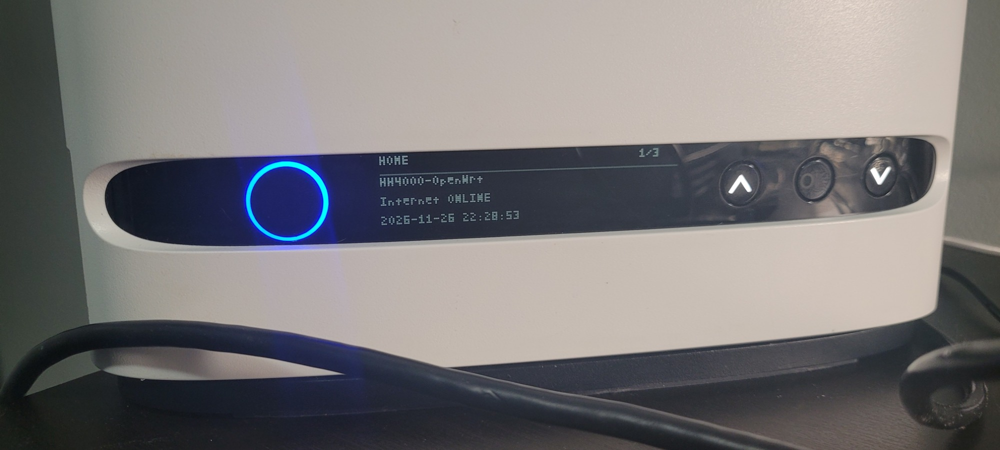

# HH4000-OpenWrt

OpenWrt integration and firmware research for the **Bell Home Hub 4000
(HH4000)**, also known as the **Sagemcom FAST5689** or **Sagemcom F@ST5689**.
The port pairs OpenWrt userspace with the Broadcom BCM6858 platform's vendor
kernel and hardware drivers.

The Bell Giga Hub (**FAST 5689E**, also written **F@ST 5689E**) is a related
model. This port has been tested on the HH4000 FAST5689, and compatibility
with the 5689E remains unverified.

To install OpenWrt on a compatible HH4000, start with the
[installation and update guide](INSTALL.md). To install using an agent, hand [this](AGENTS.md) to it. The
[research index](docs/README.md) contains the dated hardware and test notes.

The display is running the [Python status dashboard](display-script-examples/status-dashboard.py).
See the [display script examples](display-script-examples/) for how to load it.

## Current capabilities

| Area | Status |
| --- | --- |
| Ethernet | Four 1G LAN ports, configurable WAN defaulting to the 10G-capable eth4 port. A 2.5G link was verified; full 10G throughput remains untested. |
| Switching | UCI-managed LAN bridge and explicit 802.1Q devices. The vendor kernel lacks VLAN-aware bridge filtering. |
| Wi-Fi | Three vendor-driver radios, with LuCI configuration. Clean images leave Wi-Fi disabled until credentials are set. |
| Routing | Legacy iptables/firewall3, with hardware NAT observed in routed traffic. New builds include SKIPLOG rules for TUN payload traffic. |
| Display, buttons and LEDs | LuCI-configurable status pages or an optional Python program, plus a configurable rear RESET button. |
| Storage | Read-only firmware with a separate writable data overlay and a staged, data-preserving updater. |
| Optional networking | OpenVPN and HTB/FQ-CoDel SQM packages for the retained kernel. SQM pauses vendor acceleration while active. |
| Optical and voice | PON and RJ11/FXS are research areas. [PON host tests](src/hh-pon/README.md) and the [voice audit](docs/44-rj11-voice-feasibility.md) document progress. |

This is an experimental port. Use the platform's documented userspace and
matching vendor 4.1.52 kernel and drivers. The checkout needs
[local build inputs](src/openwrt-hh4000/README.md#local-build-inputs) and a
compatible boot environment for the target.

## ⚠️ Disclaimer

This project is experimental and is provided as-is, without warranty of any kind.

Flashing custom firmware and modifying bootloaders carries a real risk of permanently bricking your equipment. Do your own research, understand what you are flashing, and make proper backups before proceeding.

I am not responsible for any damage, data loss, loss of functionality, or other consequences resulting from the use of this project.

**Proceed at your own risk.**

Source files and patches retain their existing license and attribution
notices. The text for GPL-2.0-only files is in
[LICENSES](LICENSES/GPL-2.0-only.txt).
