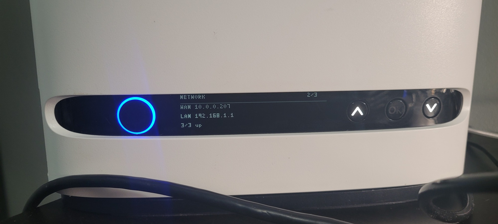
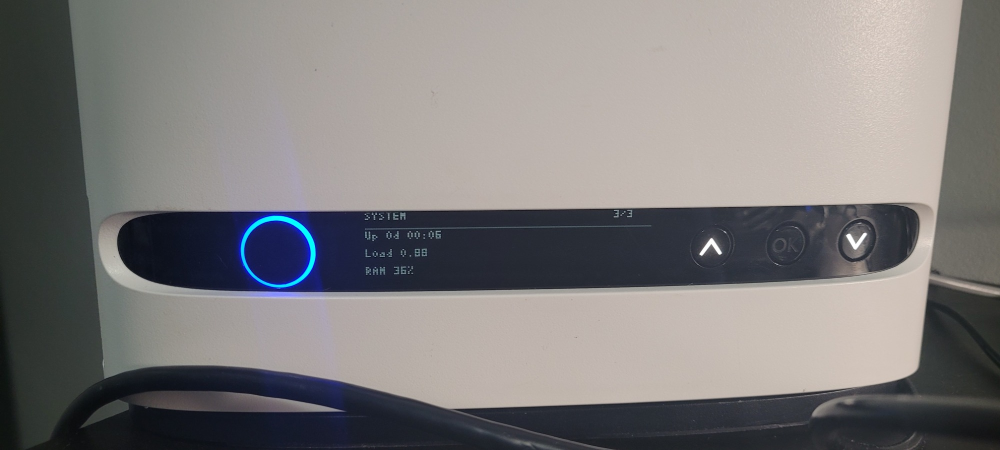

# HH4000 display script examples

[Status dashboard](status-dashboard.py) shows the router's hostname and
connectivity on Home, the WAN and LAN addresses and Wi-Fi status on
Network, and uptime, load, and memory use on System. **Up** and **Down**
cycle through the pages. The large ring button returns to Home.

## Load the dashboard

1. With Python 3 installed on your router, open **System > Front Panel**
   in LuCI.
2. Enable the front panel and select **Python** mode.
3. Paste [status-dashboard.py](status-dashboard.py) into the **Python
   program** tab and choose **Save & Apply**.

The dashboard checks connectivity by attempting TCP connections to its
configured targets every 10 seconds. The Network page displays your
router's actual addresses. For controls and template variables, see the
[front panel API guide](../docs/36-programmable-front-panel.md#python-mode).

## Dashboard photos

